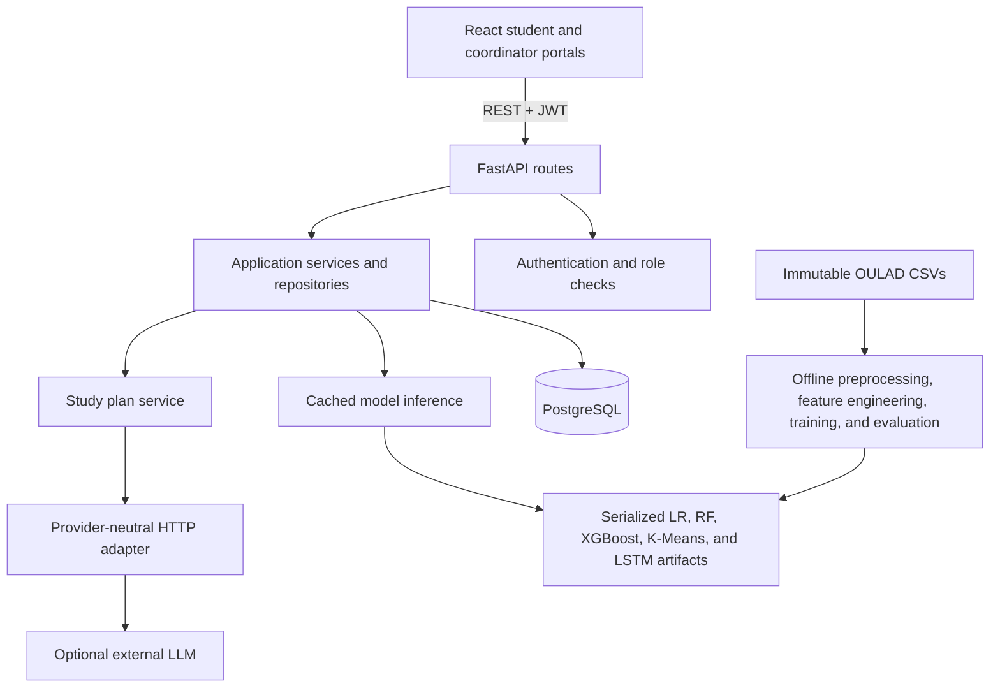

# Student Performance Prediction and Early Intervention System

A learning-focused decision-support application that combines recorded academic results and course-platform activity to help coordinators consider timely, human-reviewed support. A score is not a verdict, diagnosis, calibrated probability, or explanation of an individual student's outcome. Coordinators remain responsible for decisions and students can view their own records and optional study suggestions.

## Problem and scope

Academic and learning-platform records are often spread across systems. This project provides a traceable workflow for organizing those records, producing an early support-priority signal, and recording a human follow-up. The OULAD experiments are historical research baselines. They do not establish causal effects or readiness for institutional deployment.

## Features

- Student registration, login, JWT-backed session, profile, course performance and weekly engagement views.
- Student-facing review history, supportive study plans, motivational messages, and their own coordinator-recorded support actions.
- Coordinator dashboard, searchable and filtered student roster, student details, model review actions, cluster summaries, and intervention tracking.
- Coordinator entry forms for course enrollments, assessment schedules, assessment scores, and weekly VLE aggregates.
- Coordinator CSV validation/import for saved-model inference, plus enrollment-number access requests with coordinator approval.
- FastAPI authorization on protected operations; client route guards are only a navigation aid.
- Saved-model inference, persisted review and cluster assignments, and optional provider-neutral study-plan generation with a local fallback.
- Explicit loading, error, empty, and success states; responsive layouts and accessible form labels.

Production hosting, secret, CORS, migration, health-check, and live-smoke-test requirements are in [the production deployment checklist](docs/production-deployment.md).

## Architecture



Training runs as a separate command. API requests load cached serialized artifacts; they never train a model. React calls only FastAPI and contains no database, model-file, or LLM-provider access. See [architecture and request flow](docs/architecture.md).

## Technology stack

- Frontend: React 18, JavaScript, React Router, Axios, Chart.js, Vite, Vitest, Testing Library.
- Backend: Python 3.13, FastAPI, Pydantic, SQLAlchemy, Alembic, PyJWT, Argon2 password hashing.
- Database: PostgreSQL 16 for application use and migrations.
- ML: Pandas, NumPy, scikit-learn, XGBoost, TensorFlow/Keras.
- Generative AI: optional Google Gemini GenerateContent adapter or generic JSON-over-HTTP adapter; local supportive fallback is used when disabled or unavailable.

## Project layout

```text
backend/app/       FastAPI routes, schemas, database models, services, and inference manager
backend/alembic/   Database migrations
backend/tests/     API, authorization, database, LLM, and model-serving tests
frontend/src/      React pages, API layer, auth context, components, and flow tests
ml/features/       OULAD feature builder and temporal cohort split
ml/supervised/     Logistic Regression, Random Forest, and XGBoost training
ml/clustering/     K-Means training and cohort profiles
ml/timeseries/     LSTM and weekly logistic-baseline training
ml/inference/      Shared validated prediction boundary
ml/saved_models/   Versioned serialized model artifacts and registry
data/raw/          Original OULAD source files; never edited by the pipeline
data/processed/    Derived datasets, source manifest, and evaluation reports
scripts/           Reproducible application-data import commands
docs/              Data, feature, architecture, API, model, and responsible-use guides
tests/              Feature-contract and inference tests
```

## Dataset and feature pipeline

The project uses the seven OULAD CSVs: `assessments.csv`, `courses.csv`, `studentAssessment.csv`, `studentInfo.csv`, `studentRegistration.csv`, `studentVle.csv`, and `vle.csv`. Put them under `data/raw/oulad/`; the existing extracted workspace path `data/raw/raw/oulad/` is also recognized. Raw files are read-only. `data/processed/student_training_dataset.csv` is a historical-only canonical export with OULAD source keys and namespaced source-record IDs; it has no application enrollment numbers or demographics. The application's live enrollment-number registry is application-account-only. Read the [identity and feature contract](docs/processed-dataset-schema.md) before using either data path.

The supervised target is final `Fail` or `Withdrawn` versus `Pass` or `Distinction`. Inputs use the presentation's relative days 0–55. Withdrawals already recorded before day 56, and withdrawals without a known unregistration time, are excluded from the forecast cohort because those outcomes are not reliably future outcomes at scoring time. `date_unregistration` is used only for cohort eligibility, never as a feature. The input contract excludes demographics and student identifiers. It derives assessment means/counts/timing/coverage and VLE clicks, distinct active dates, weeks, sites, and activity types from source columns. No attendance value is fabricated.

Read [the data dictionary](docs/data-dictionary.md) and [feature contract](docs/feature-contract.md) before changing transformations.

## Historical data and live application records

Historical OULAD rows are not application students or enrollments and are not imported into the live database. To rebuild the historical canonical features and eight-week sequences without training models or writing to a database, run:

```powershell
.\.venv\Scripts\python.exe -m ml.features.export_canonical
```

The former `scripts/import_oulad.py` command is retained as a safety guard and exits with instructions; it cannot write OULAD records into `Student` or `Enrollment`. New coordinator uploads still require a real, active application enrollment number and matching module/presentation. Historical source identifiers are not translated or accepted as live identities. See the [historical identity boundary](docs/oulad-database-import.md).

## Models and evaluation

- Supervised classifiers: Logistic Regression, Random Forest, and XGBoost, each with a saved preprocessing pipeline.
- Behavioral clustering: K-Means, with imputation/scaling learned from the training cohort and raw median profiles for interpretation. Cluster IDs have no normative names.
- Sequential model: an eight-week LSTM on ordered weekly VLE clicks and active days, compared against a logistic regression on the same flattened sequence.
- Evaluation: chronological 2013B/2013J training, 2014B validation, and 2014J test. Student IDs appearing in an earlier partition are purged from later partitions. Threshold selection uses validation F2; the held-out test is not used for model or threshold selection.

Reports are in `data/processed/supervised_evaluation.json`, `clustering_evaluation.json`, and `lstm_evaluation.json`; artifacts and selected-model metadata are in `ml/saved_models/registry.json`. Metrics describe one historical dataset and one later presentation, not a deployment guarantee. Review recall, false negatives, false positives, calibration, and coordinator capacity together. See [model evaluation](docs/model-evaluation.md), [K-Means](docs/clustering.md), and [LSTM](docs/lstm-pipeline.md).

With the current source snapshot, day-56 eligibility leaves 26,447 records. XGBoost narrowly led validation F2 (0.813) and is the registered supervised model. On the student-disjoint 2014J test it reached F2 0.758, recall 0.948, and ROC-AUC 0.770, with 143 false negatives and 3,541 false positives. Random Forest had the highest test ROC-AUC (0.778); the model choice follows the declared validation F2 rule, not a claim of universal superiority. The LSTM test ROC-AUC was 0.721 (F2 0.743), only a small lift over its weekly logistic baseline (0.716/0.739). See the evaluation guide for confusion matrices, thresholds, and cluster profiles.

## Database and API

Alembic migrations define users, student profiles and enrollment numbers, coordinator-reviewed access requests, course enrollments, assessment schedules, academic records, weekly engagement, predictions, cluster assignments, CSV import snapshots, interventions, study plans, and motivational messages. Database credentials are environment-only. The API documents authentication, records, model inference, study plans, interventions, and analytics at `/docs` and in [API documentation](docs/api-documentation.md).

New students receive a stable application-generated enrollment number and can see their own profile while awaiting coordinator review. A student request must match that account's assigned number; coordinators approve or reject it, and academic/support record routes stay unavailable until approval. Enrollment numbers are identifiers, not passwords. Students can read only their own profile and records. Coordinators are required for roster/aggregate analytics, course record entry, inference requests, and intervention changes. Student cross-account access is hidden as 404. Coordinator account registration requires an invite code.

## Authentication and LLM boundaries

Passwords are Argon2 hashes. The backend issues short-lived HS256 JWTs and rechecks the active user and database role on each protected request. React stores the access token in `localStorage` to match the current API; before public deployment, assess an HttpOnly-cookie session with CSRF protection and a strict content security policy.

Study-plan generation receives only a small structured summary (review band, recent scores, coarse activity counts, and optional cluster ID). Names, email addresses, account IDs, demographics, and free-text notes are excluded. The LLM can write supportive suggestions; it does not produce the risk prediction. Provider failures and rejected content use a local fallback. Keys remain in the backend environment. See [responsible AI controls](docs/responsible-ai.md).

## Environment variables

Copy `.env.example` to `.env` and replace each `REPLACE_WITH_...` value locally. The template contains placeholders only.

| Variable | Purpose |
|---|---|
| `POSTGRES_DB`, `POSTGRES_USER`, `POSTGRES_PASSWORD`, `POSTGRES_PORT` | Local Compose database settings |
| `DATABASE_URL` | SQLAlchemy PostgreSQL connection string |
| `JWT_SECRET_KEY` | At least 32 random characters for HS256 signing |
| `ACCESS_TOKEN_EXPIRE_MINUTES` | JWT lifetime, from 1 to 1440 |
| `COORDINATOR_INVITE_CODE` | Separate secret for coordinator registration |
| `CORS_ORIGINS` | Comma-separated allowed browser origins |
| `LLM_PROVIDER` | `disabled`, `gemini`, or `http_json` |
| `GEMINI_API_KEY`, `GEMINI_MODEL` | Optional server-side Gemini key and model; never put these in frontend settings |
| `LLM_ENDPOINT`, `LLM_API_KEY`, `LLM_TIMEOUT_SECONDS` | Optional generic JSON-over-HTTP provider settings; server-side only |
| `VITE_API_BASE_URL` | Frontend API origin/path, set in `frontend/.env.local` from `frontend/.env.example` |

Vite variables are public browser configuration; never put secrets in them.

## Install and run (Windows PowerShell / VS Code)

The backend reads its PostgreSQL connection from root `.env`. The checked-in `.env.example` is a local template; set `DATABASE_URL` to your PostgreSQL connection string. Neon URLs should use the installed psycopg 3 driver, for example `postgresql+psycopg://...?...sslmode=require`. Keep the URL and all credentials private. `schema.sql` is a readable snapshot generated from the Alembic migration history; Alembic remains the source of truth.

Run the setup and app from the repository root:

```powershell
if (-not (Test-Path .env)) { Copy-Item .env.example .env }
npm run setup       # creates the venv first if needed, then installs Python and frontend packages
npm run migrate     # creates/updates the schema in DATABASE_URL
npm run dev         # applies pending migrations, starts API on 8001 and frontend on 5173
```

`npm run db` starts the optional local Docker PostgreSQL container. Do not run it when you intend to use Neon. For the frontend alone, configure `frontend/.env.local` from its example and run:

```powershell
npm --prefix frontend run dev -- --host=127.0.0.1 --port=5173
```

Open the Vite URL at `http://127.0.0.1:5173`. FastAPI is at `http://127.0.0.1:8001`, Swagger UI at `/docs`, and readiness at `/health`. A coordinator registers at `/register` using `COORDINATOR_INVITE_CODE`; students can self-register.

Model review requires course enrollment data and all eight weekly records for course weeks 0–7. A coordinator can run model review, weekly forecast, and engagement group refresh from a student's detail page. Missing weeks are not treated as zero activity.

Gemini personalization is optional. To enable it, set `LLM_PROVIDER=gemini`, provide a server-side `GEMINI_API_KEY`, and choose a supported `GEMINI_MODEL` in root `.env`. When disabled or unavailable, the app uses its local fallback.

VS Code tasks are available for migrations, backend/frontend startup, tests, and model training. The backend startup task applies pending migrations before launching FastAPI.

## Train models

With the raw CSVs in one supported location and ML dependencies installed:

```powershell
.\.venv\Scripts\python.exe -m ml.supervised.train
```

This command verifies the source snapshot, rebuilds processed features and ordered weekly sequences, trains and evaluates the supervised candidates, K-Means, LSTM, and weekly logistic baseline, then updates the registry. TensorFlow training can take several minutes on CPU. Do not run training from an API handler.

Training writes the historical canonical `data/processed/student_training_dataset.csv` with one row per eligible student-course, stable `oulad:student-course:v1:<sha256>` IDs, and the original source student ID/course keys. It never assigns application enrollment numbers to historical rows. The header-only live upload template remains at `data/templates/student_upload_template.csv`. To rebuild only the canonical export without changing model artifacts, use `python -m ml.features.export_canonical`. See [the processed dataset and coordinator upload schema](docs/processed-dataset-schema.md).

## Tests and checks

```powershell
.\.venv\Scripts\python.exe -m pytest -q
cd frontend
npm test
npm run build
npm audit
```

Backend tests use isolated SQLite databases for persistence and migration behavior; the saved-model tests load and score actual artifacts. Frontend portal tests mock the API service boundary. A PostgreSQL server is still required for production-like migration and runtime verification. Local SQLite is suitable for a single-user development smoke run, not concurrent or production use.

## Limitations and next work

- The OULAD labels and features are historical and observational; no causal effect, student intent, or attendance is measured.
- Validation and test use one later presentation each; external, subgroup, calibration, and ongoing-drift studies are still needed.
- The test set's operating threshold can produce many false positives; staffing capacity and student-centered review policy must be agreed before operational use.
- K-Means silhouette is descriptive, not proof that segments are stable or useful.
- The LSTM uses only eight weeks and currently does not show compelling improvement over its logistic sequence baseline.
- Automated Gemini adapter tests use mocked provider responses; live generation requires the server-side key and network access. The local integration run live-verified `gemini-3.5-flash-lite`; Google can change model availability independently of this code.
- PostgreSQL production startup and migrations require a reachable PostgreSQL 16 service.

Recommended next improvements: repeat evaluation across cohorts, assess subgroup fairness and calibration, review intervention outcomes with educators and students, tighten session storage/CSP before deployment, and add governed bulk data import with provenance and retention controls.
