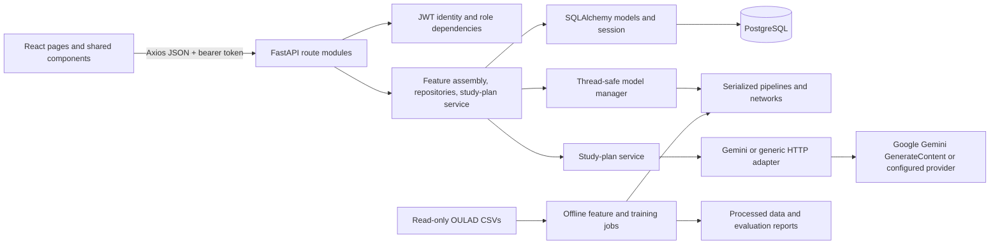

# System architecture

## Runtime and training boundaries

The frontend knows only the FastAPI base URL. It does not access PostgreSQL, model files, or provider APIs. The backend owns authentication, authorization, validation, persistence, inference, and LLM calls. Training is an offline command and is not imported or invoked by request handlers.

## Trace a request

### Student page read

1. A page in `frontend/src/pages/` calls a function from `frontend/src/api/services.js`.
2. `frontend/src/api/client.js` adds the bearer token and sends the request to the configured API URL.
3. A route in `backend/app/api/routes/` validates the path, query, and body, then applies dependencies from `backend/app/core/dependencies.py`.
4. The route uses SQLAlchemy models/repositories and `backend/app/db/dependencies.py` to read or write the configured database.
5. Pydantic response schemas serialize only the public fields. The page's `useResource` hook represents loading, error, retry, and success states.

### Supervised model review

1. A coordinator selects **Run model review** on a student enrollment.
2. `POST /api/predictions/{student_id}` checks the coordinator role and confirms enrollment ownership.
3. `backend/app/services/feature_assembly.py` aggregates scheduled assessments, saved assessment scores, and weekly VLE records into the versioned feature contract.
4. `ModelManager` loads the selected serialized scikit-learn pipeline once per process, checks feature version/order, and reuses the loaded object. The prediction and model metadata are persisted in `predictions`.
5. The endpoint returns the saved model score, threshold, review band, versions, and observed numeric inputs. Student and coordinator pages display it as a human-review signal.

### Study-plan generation

1. The student requests a plan for an enrollment with an existing saved model review.
2. The study-plan route loads only a small structured context from saved records.
3. `StudyPlanService` uses the configured provider adapter or a local fallback. It does not call an ML model to decide risk.
4. Schema and unsafe-language validation run before the plan and motivational message are persisted.
5. The browser reads the saved plan and message through the student API.

### Weekly sequence review

1. A coordinator records one explicit weekly aggregate for each of weeks 0-7.
2. **Run weekly forecast** calls `POST /api/predictions/{student_id}/sequence` with only the enrollment ID.
3. The backend refuses to score if any of those eight weeks is unrecorded; a zero row means a week was observed and had no activity.
4. The cached LSTM and its saved scaler score the ordered 8x2 sequence, and the result is persisted with the model and feature versions.
5. Students can view the persisted review in their support history.

## Source tree boundaries

- `frontend/src/auth/`: session context and client route guards.
- `frontend/src/api/`: API base URL, bearer-token handling, friendly errors, and route wrappers.
- `frontend/src/components/`: application shell, accessible forms, reusable cards/tables/charts/state views, and coordinator record-entry forms.
- `frontend/src/pages/`: student and coordinator workflows.
- `backend/app/api/routes/`: HTTP concerns and request-level authorization.
- `backend/app/schemas/`: strict input and response shapes.
- `backend/app/services/`: feature assembly and provider-neutral generation orchestration.
- `backend/app/llm/`: generation service plus Google Gemini and generic HTTP provider adapters.
- `backend/app/repositories/`: student/profile retrieval.
- `backend/app/models/` and `backend/app/db/`: relational model definitions, engine, and request sessions.
- `backend/alembic/`: schema change history.
- `backend/app/ml/model_manager.py`: lazy, thread-safe loading and reuse of inference artifacts.
- `ml/features/`, `ml/supervised/`, `ml/clustering/`, `ml/timeseries/`: reproducible offline pipeline stages.
- `ml/inference/`: shared feature validation and model scoring functions used by the API.

## Database relationships

`users` has a one-to-one student profile for student roles. Each student can have multiple `enrollments`. Enrollment-owned records are `assessment_schedule`, `academic_records`, `engagement_records`, `predictions`, `behavioral_clusters`, `interventions`, `study_plans`, and `motivational_messages`. Prediction and intervention rows reference the user who requested or created them. A study plan can retain the prediction it was based on; messages can reference their plan. Foreign keys use restrictive or cascading deletion according to ownership. Unique constraints prevent duplicate enrollment keys, one weekly record per enrollment/week, and duplicate assessment scores for the same enrollment/assessment.

See [database schema](database-schema.md) for field, constraint, and index details.

## Authentication and trust boundaries

The API signs short-lived HS256 JWTs using the server-only `JWT_SECRET_KEY`. For each protected request it validates signature, expiration, subject, token type, active account, and that the token role still matches the database role. Student ownership is checked on student-specific operations. Coordinator permissions are enforced in backend dependencies; React route guards only shape navigation.

The client currently stores bearer tokens in `localStorage`. It uses no external script or font dependency by default, but an XSS flaw could expose a stored token. Before deployment, use a reviewed content security policy and consider HttpOnly cookies with CSRF defenses. See [responsible AI and privacy](responsible-ai.md).

## Feature and model artifact boundary

The `oulad-early-risk-v2` contract is the shared meaning and order of the tabular supervised fields. The backend derives it from stored source aggregates; callers cannot submit feature dictionaries or sequence tensors. The selected estimator, threshold, preprocessing steps, feature version/order, K-Means transform, and LSTM scaler/network are saved under `ml/saved_models/` and cross-checked by inference code. Model metadata and training reports are in the model registry and `data/processed/`.

## Configuration

The backend loads `.env` from the project root via Pydantic settings; Compose reads the same file for PostgreSQL. The Vite client reads `frontend/.env.local` and exposes only `VITE_API_BASE_URL` to the browser. LLM credentials and database credentials are not frontend configuration. `CORS_ORIGINS` lists exact browser origins.

## Important deployment boundary

`/health` is a database readiness check and returns 503 while the configured database cannot answer `SELECT 1`. PostgreSQL 16 is the supported application database. The automated migration suite uses SQLite for fast isolated checks, so successful SQLite migrations do not replace a live PostgreSQL migration/startup check.
