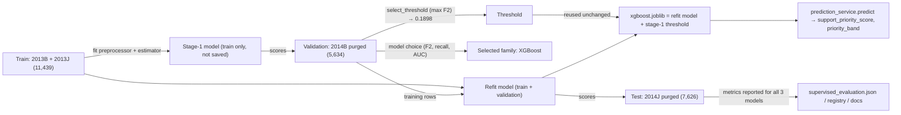
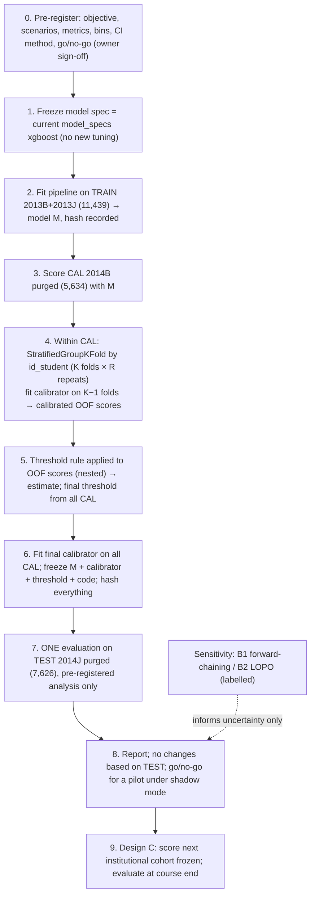

# NorthStar: Leakage-Free Calibration, Threshold, and Evaluation Protocol (Design)

| | |
|---|---|
| Document type | **Design only.** Nothing in this document has been implemented, trained, calibrated, or deployed. |
| Date (UTC) | 2026-10-10 |
| Scope | Selected supervised early-risk model (`xgboost`, v1.2.0, feature contract `oulad-early-risk-v2`) |
| Inputs | `ml/supervised/train.py`, `ml/features/build_dataset.py`, `ml/inference/prediction_service.py`, `ml/saved_models/registry.json`, `data/processed/supervised_evaluation.json`, `docs/model-evaluation.md`, `docs/ml-pipeline.md`, `reports/calibration_audit_20261010T014038Z_saved_artifact_validation/REPORT.md` (called **A2** here) and its predecessor `reports/calibration_audit_20261010T012653Z/REPORT.md` (**A1**) |
| Evidence tags | **[Verified]** = re-checked against project files or data for this document · **[Prior audit]** = taken from A1/A2 and not recomputed here · **[Design]** = proposal · **[DECISION]** = needs stakeholder approval; no value is assumed |

---

## 1. Executive summary

**Current state.** The saved model and the stored threshold are **not a validated matched pair**.
- The threshold (0.18982425) was chosen on 2014B scores from a model trained only on 2013B/2013J.
- The saved model was then refit on 2013B+2013J+2014B, and the threshold was reused unchanged.
- No calibrator exists.
- Every validation figure computed from the saved model is in-sample.
- The only remaining labelled holdout (2014J) has been evaluated across several pipeline versions. It is no longer pristine for selection purposes, though it has never been used to fit or select anything.

**Data limits.** OULAD contains **only four presentations** (2013B, 2013J, 2014B, 2014J), with uneven module coverage:
- 2013B covers only 3 of the 7 modules.
- Module CCC first appears in 2014B.
- Module AAA is absent from 2014B.

These four presentations cannot support four mutually independent chronological partitions (train / model-select / calibrate-and-threshold / final test) without training on a fragment of the course catalogue.

**Recommendation.** A staged, hybrid protocol:

1. **Primary retrospective protocol: Design A′, no-refit matched pair.**
   - Train on 2013B+2013J with the *already fixed* model specification.
   - Use 2014B **only** for calibrator fitting and threshold selection, with both cross-fitted by student inside 2014B.
   - **Deploy exactly that model, without refitting.**
   - Evaluate once on 2014J under a pre-registered analysis plan.
   - Report 2014J as a *repeatedly viewed* holdout, not a pristine one.
2. **Sensitivity analysis: Design B, forward-chaining cross-fitting.** Use it to estimate how unstable calibration and threshold are across cohorts, and the cost of the refit. It is **not** the source of the deployed threshold.
3. **Acceptance gate for operational use: Design C, prospective frozen evaluation** on a later cohort from the deploying institution. This is the only design that tests the actual deployment population and genuinely unseen time periods. It has its own hazard: outcomes of flagged students can be changed by the support they receive.

**What the current data can establish:**
- Ranking quality of a frozen model on one later OULAD presentation.
- Calibration of a model + calibrator pair on one later OULAD presentation.
- Threshold behaviour (alert rate, recall, precision) on that presentation.

**What it cannot establish:**
- Calibration or alert volume on the deploying institution's students.
- Stability across more than one future cohort.
- Presentation-level variance.
- A cost-optimal threshold, because no costs or capacity have been defined.

**No production threshold is recommended.** The operating objective has not been set.

---

## 2. Verified current-state findings

### 2.1 Claims from the previous audit

| Claim | Status | Evidence (re-checked for this document) |
|---|---|---|
| 26,447 eligible records | ✔ Verified | Canonical CSV row count; `supervised_evaluation.json` `cohort_eligibility.eligible_rows` |
| Train 2013B+2013J, validation 2014B, test 2014J | ✔ Verified | `ml/features/build_dataset.py:199-201` `_student_disjoint_presentation_split`; evaluation JSON `split` |
| Repeat students purged across partitions | ✔ Verified, with nuance | 580 validation and 1,168 test rows purged (`split_diagnostics`). **Within** a partition, repeats are kept: 100 students appear in both 2013B and 2013J inside train, and **578 rows** belong to students with more than one module in the same presentation. This matters for cross-fitting and for bootstrap CIs (§6.5). |
| Saved XGBoost refit on train+validation (has seen 2014B) | ✔ Verified | `train.py:105-107` `final.fit(X_all, y_all)`. The artifact's one-hot categories include `2014B`, and its imputer medians equal the train+validation medians (A2 `results.json`, re-read). |
| Threshold ≈ 0.189824 | ✔ Verified | `xgboost.joblib["threshold"]` = 0.18982425332069397 = `supervised_evaluation.json.selected_threshold`; the registry stores 0.189824 (rounded) |
| Threshold chosen by validation F2 on the train-only model, reused after refit | ✔ Verified | `train.py:94-96` (fit on train, `select_threshold` on validation) → `:102-113` (refit; `cutoff` reused and saved) |
| Train-only validation ROC-AUC ≈ 0.801, Brier ≈ 0.179, log loss ≈ 0.532 | ✔ Verified (prior computation re-read) | A2 `results.json`: 0.80083 / 0.17858 / 0.53206. The ROC-AUC also equals the recorded `validation_results.xgboost.validation.roc_auc`. |
| ≈85% of validation flagged at the threshold | ✔ Verified | 4,800 of 5,634 = 85.2% (TP 2,413 + FP 2,387 = recorded confusion matrix) |
| Docs say scores are not calibrated probabilities | ✔ Verified | `docs/model-evaluation.md` ("Scores are not calibrated probabilities"), `docs/responsible-ai.md:7`, `docs/api-documentation.md:97` |

### 2.2 Additional facts found while verifying [Verified]

**Presentations and module coverage (eligible rows, before purge):**

| Module | 2013B | 2013J | 2014B | 2014J |
|---|---|---|---|---|
| AAA | – | 365 | **–** | 342 |
| BBB | 1,472 | 1,787 | 1,248 | 1,737 |
| CCC | **–** | **–** | 1,362 | 1,852 |
| DDD | 1,086 | 1,578 | 972 | 1,402 |
| EEE | – | 906 | 586 | 994 |
| FFF | 1,409 | 1,918 | 1,256 | 1,771 |
| GGG | – | 918 | 790 | 696 |
| **Total** | 3,967 | 7,472 | 6,214 | 8,794 |
| Positive rate | 0.472 | 0.401 | 0.460 | 0.380 |

What follows from the table:
- **CCC never appears in the training partition.** The train-only model scores CCC as an unseen `code_module`, while the refit model has seen it. This is a concrete mechanism behind A1's finding that CCC is over-predicted by about 12 pp on validation. It also shows that calibration measured on the train-only model cannot transfer to the refit model.
- **AAA has no 2014B rows**, so its calibration and threshold behaviour cannot be checked on validation at all.
- **Prevalence moves between presentations** by up to 9 pp, and B presentations run higher than J. Calibration-in-the-large is therefore expected to drift.
- **`code_presentation` is a model feature.** Every future cohort is an unseen category, so its one-hot columns are all zero (A1 §5.6).

**Sizes after sequential student purge (2013B → 2013J → 2014B → 2014J):**

| Presentation | Rows kept | Positives |
|---|---|---|
| 2013B | 3,967 | 1,872 |
| 2013J | 7,372 | 2,920 |
| 2014B | 5,634 | 2,510 |
| 2014J | 7,626 | 2,726 |

### 2.3 Current data flow [Verified]

| Role | Data used today | Function / location |
|---|---|---|
| Fit preprocessor and estimator (stage 1) | Train | `make_preprocessor`, `model_specs`, `train_all` (`train.py:92-94`) |
| Model selection | Validation (stage-1 scores) | `train_all` (`train.py:100-101`) |
| Threshold selection | Validation (stage-1 scores) | `select_threshold` (`train.py:63-67, 96`) |
| Class weight (`scale_pos_weight`) | Train only, reused unchanged at refit | `train.py:90, 106` |
| Calibrator | **None** | — |
| Fit deployed preprocessor and estimator | Train + validation | `train.py:105-107` |
| Final evaluation | Test, for all 3 refit candidates | `train.py:108-109` |
| Inference | Saved refit pipeline + stage-1 threshold | `prediction_service.load_model`, `predict`; `backend/app/ml/model_manager.py` `_load_supervised` |

---

## 3. Existing leakage and validation limitations

| # | Limitation | Consequence |
|---|---|---|
| L1 | **Model and threshold are not a validated pair.** The threshold belongs to the stage-1 model; the artifact holds the refit model. | Alert volume and recall of the deployed pair have never been estimated on data the deployed model has not seen, other than test. A1's simulations showed reused thresholds shifting flag rates by −2.4 to +7 pp. |
| L2 | **Validation scores of the saved model are in-sample.** | AUC 0.848 vs 0.801 out-of-sample (A2). Any decision taken from them is leakage-driven. |
| L3 | **Validation does triple duty:** model selection, threshold selection, and refit training data. | Selection optimism. A1 measured it as small (≈0.002 F2), but it is not zero. |
| L4 | **The test holdout has been viewed repeatedly.** `docs/ml-pipeline.md` records regenerated reports after an earlier audit, and test metrics for all three models are discussed in `docs/model-evaluation.md`. A1 added one more descriptive look at test calibration. | 2014J remains useful as a check never used for fitting, but it cannot be called genuinely unseen. Any new protocol must say so. |
| L5 | **No calibration step.** The score is `predict_proba[:,1]` of a class-weighted model (`scale_pos_weight` ≈ 1.349). | Systematic over-prediction (A1: validation +3.7 pp; test +11.1 pp). |
| L6 | **Unseen-category structure.** `code_presentation` is always unseen at scoring time; CCC is unseen by the stage-1 model; AAA has no validation rows. | Level shifts that cannot be validated, and module-dependent calibration. |
| L7 | **Single presentation per role.** | Variance between presentations cannot be estimated from any one split. Row-level CIs understate true uncertainty. |
| L8 | **The F2 objective is not tied to an operational constraint.** | It flags about 80–85% of students. No capacity or cost decision is recorded anywhere in the source or docs. |
| L9 | **Tests do not guard threshold provenance or score semantics** (A2 Finding 6). | A future refit can silently reintroduce L1. |

---

## 4. Comparison of evaluation designs

In all designs the following rules hold:
- **Preprocessing is fitted inside the pipeline** on the fitting rows only, as `make_preprocessor` already does.
- **Students are purged forward**: once a student appears in an earlier role, their later rows are removed.
- **Within-role student grouping** is used for any K-fold.

### Design A: dedicated chronological partitions

**A-strict (four roles, four presentations).**

| Role | Data | Rows | Note |
|---|---|---|---|
| Train | 2013B | 3,967 | BBB/DDD/FFF only |
| Model selection | 2013J | 7,372 | |
| Calibration + threshold | 2014B | 5,634 | |
| Final test | 2014J | 7,626 | |

- Training would see **only 3 of 7 modules** and fewer than 4k rows.
- AAA, CCC, EEE, and GGG would all be unseen modules at every later stage.
- The model would be unrepresentative of the one actually wanted.
- **Not recommended.** The current data does not adequately support it.

**A′ (recommended primary): three roles, no refit.**

| Role | Data | Rows |
|---|---|---|
| Train | 2013B+2013J | 11,439 (unchanged) |
| Calibration + threshold | 2014B | 5,634 |
| Final test | 2014J | 7,626 |

- **Model selection is not repeated.** The model family and hyperparameters are frozen at the current `model_specs` before the protocol starts. This uses the existing (2014B-based) choice and accepts the bias already incurred, instead of spending 2014B again.
- **The deployed artifact is exactly the train-only model**, with no refit.

| Aspect | Assessment |
|---|---|
| Advantages | The model, calibrator, and threshold form a genuinely matched pair. Calibration and threshold data are later than all training data. It is simple and auditable, and A1 already showed the stage-1 model reproduces bit-for-bit. |
| Weaknesses | It forgoes the 2014B training data, so CCC remains an unseen module (about 13–16% of later cohorts). A single calibration presentation of 5,634 rows. Calibrator and threshold share 2014B, so cross-fitting is needed to keep them honest (§6, §7). |
| Leakage risks | Reusing 2014B for any new model or hyperparameter change. Isotonic over-fitting. Looking at 2014J before freezing. |
| Minimum assumptions | 2014B is representative enough of the next cohort for calibration, which A1 showed was weak for 2014J. Exchangeability within 2014B after grouping by student. |
| Feasible now? | **Yes** |
| Extra data needed | None to run it. More presentations are needed to make calibration claims generalise. |

**A″ (variant): split 2014B by student into a model-selection half and a calibration half (~2.8k each).** Use this only if a *new* model or hyperparameter search is ever approved. Both halves come from the same presentation, so they are not chronologically independent. Feasible, but small.

### Design B: cross-fitted calibration and threshold selection

Out-of-fold (OOF) predictions are produced so that no row is scored by a model, or by preprocessing, that was fitted on that row.

| Variant | Folds | Chronology | Assessment |
|---|---|---|---|
| **B1: forward-chaining** | Fit 2013B → score 2013J (purged); fit 2013B+2013J → score 2014B (purged) | Respected | OOF rows: 7,372 + 5,634. The first fold's model has seen only 3 modules, so its 2013J scores are unrepresentative. Pooling OOF scores from models of different quality distorts calibration. **Use as a sensitivity analysis only.** |
| **B2: leave-one-presentation-out** over {2013B, 2013J, 2014B} | 3 folds, each scored by a model trained on the other two | **Violated**: earlier cohorts are scored by models that saw later cohorts | It measures cross-cohort transfer, but optimistically for forward deployment. Purging must be two-way, removing students shared with any other fold. Acceptable only as a sensitivity analysis, labelled "non-chronological". |
| **B3: grouped K-fold within train+validation** (`StratifiedGroupKFold`, group = `id_student`) | K folds, mixed presentations | Ignored | Removes row-level and student-level self-leakage, but measures *in-distribution* calibration. Optimistic about temporal drift. **Not recommended** for threshold or calibration decisions. |

**Refit-mismatch problem (common to all B variants).** The final model is fitted on more data than any fold model. Its score distribution therefore differs from the OOF distribution on which the calibrator and threshold were fitted.
- A1 measured this as a −2.4 to +7 pp change in flag rate and a mean-score shift of up to 0.07.
- Cross-fitting cannot remove this mismatch.
- Mitigations:
  - **Do not refit.** This collapses B into A′.
  - **Bag the fold models** and deploy the ensemble (the average of fold-model scores), so the deployed scorer *is* the cross-fitted scorer. This changes inference, so it would need separate approval.
  - **Quantify the mismatch** with a refit-transfer simulation and report it as an uncertainty, not a correction.

| Aspect | Assessment |
|---|---|
| Advantages | Uses more labelled rows for calibration. Gives cross-cohort variability estimates, which no single split can. |
| Weaknesses | Refit mismatch. Unequal fold models (B1). Chronology violation (B2). Optimism (B3). |
| Leakage risks | Preprocessing fitted outside the fold loop. Not grouping by `id_student` (578 within-presentation repeat rows). Selecting the threshold on the same OOF scores used to report it (use nested selection). |
| Feasible now? | B1/B2: yes, as sensitivity analyses. As the primary source of the deployed threshold: not recommended. |
| Extra data needed | More presentations would make B1 strong. |

### Design C: prospective future-cohort evaluation

1. **Freeze** the model artifact hash, preprocessing, calibrator, threshold rule and value, metric definitions, analysis code, and the go/no-go criteria (§9) **before** any later-cohort data is scored.
2. **Score** the new cohort at the prediction boundary (day 56).
3. **Wait** for end-of-course outcomes.
4. **Evaluate** exactly as pre-registered.

| Aspect | Assessment |
|---|---|
| Why strongest | It is the only design whose evaluation data is genuinely unseen in time *and* drawn from the deployment population. NorthStar scores the deploying institution's students, not OULAD students, so 2014J can never test that population shift. Nothing about it can have influenced any decision. |
| Weaknesses | Label lag of a full presentation. One cohort per evaluation cycle. **Intervention confounding:** if flags trigger support that works, flagged students' observed outcomes improve and both recall and calibration look worse than they really are (performative prediction). Feature definitions must match the OULAD-derived contract. |
| Leakage risks | Peeking at interim outcomes and adjusting. Changing the threshold mid-cohort. Using the cohort's outcomes to recalibrate and then reporting performance on that same cohort. |
| Confounding controls (all [DECISION]) | (a) **Shadow mode**: compute and log scores but do not surface them, so current practice continues. This yields unconfounded outcomes, but means the cohort does not benefit from the model. (b) Log every intervention so that analyses can stratify by intervention status, accepting residual bias. (c) Any randomised hold-back is an ethics and governance question outside this document and must not be assumed. |
| Minimum assumptions | Live features are computed identically to the contract (`backend/app/services/feature_assembly.py`). Outcome labels are defined identically (Fail/Withdrawn on or after day 56 vs Pass/Distinction). |
| Feasible now? | **No.** OULAD has no later presentations. It requires future institutional data, so it is a governance commitment, not a retrospective analysis. |
| Extra data needed | At least one labelled future presentation from the deploying context. Several are needed for stability. |

### Recommendation

| Use | Design | Reason |
|---|---|---|
| Produce a matched model + calibrator + threshold now | **A′** | Feasible, chronological, matched pair, no refit mismatch |
| Quantify cohort-to-cohort instability | **B1** (and B2, labelled non-chronological) | The only way to see variance across presentations with the current data |
| Decide whether to use the model operationally | **C** | Only C tests the real population and genuinely unseen time |

**Trade-off accepted under A′.** The deployed model learns from about 11.4k rows instead of 17.1k, and treats CCC as an unseen module. If the project owner values the extra 2014B training data more than a matched, validated pair, the alternative is to refit and accept the measured mismatch from B1, then rely on C for validation. Either way, **this is a [DECISION]**.

---

## 5. Recommended protocol with explicit data boundaries [Design]

| Step | Fits | Selects | Data | Never touches |
|---|---|---|---|---|
| 2 | Imputer, scaler, one-hot, XGBoost | — | Train | 2014B, 2014J |
| 4 | Calibrator (fold-wise) | — | 2014B folds K−1 | Held-out fold, 2014J |
| 5 | — | Threshold (by the pre-registered rule) | 2014B OOF calibrated scores, nested | 2014J |
| 6 | Final calibrator | — | All of 2014B | 2014J |
| 7 | — | — | 2014J, evaluation only | — |

**Hard rules:**
- No step may read 2014J labels before step 6 is frozen and hashed. A1's "freeze then hash" mechanism (`results_validation_frozen.json`) is the template.
- If any step-7 result triggers a change, the 2014J result is reported as **spent**. The change must be validated under Design C, not re-tested on 2014J.

---

## 6. Calibration methodology [Design]

### 6.1 What gets evaluated
1. **Raw scores** of model M on 2014B: the baseline.
2. **Cross-fitted calibrated scores** on 2014B (OOF): the calibration estimate.
3. **Frozen M + final calibrator on 2014J**: the final, single evaluation.

The calibrator is fitted on M's 2014B scores, using 2014B labels from the K−1 training folds only. Calibration is assessed independently on the held-out folds' OOF predictions (2014B), and once on 2014J.

### 6.2 Metrics (all pre-registered)

| Metric | Definition | Notes |
|---|---|---|
| Brier score | mean (p − y)² | Also report the prevalence-only reference p̄(1 − p̄) and the skill score 1 − Brier/reference |
| Log loss | −mean[y ln p + (1 − y) ln(1 − p)], p clipped to [1e-15, 1 − 1e-15] | Report the prevalence-only reference |
| Calibration-in-the-large | logit shift α such that mean σ(logit p + α) = observed prevalence | The most sensitive to cohort prevalence shift |
| Calibration slope / intercept | Logistic regression of y on logit p | Slope < 1 means over-confident |
| Reliability table | **Fixed** 10 equal-width bins on [0, 1] **and** 10 equal-count bins; per bin: n, positives, mean p, observed rate, Wilson 95% CI | Fixed edges make tables comparable across cohorts. Flag bins with n < [DECISION: minimum bin n]. |
| ECE | Σ (n_b/N)·\|mean p_b − observed_b\| for each bin scheme | Biased and binning-dependent. Report both schemes, never as the only calibration criterion. |
| ROC-AUC | Ranking, for context | Unchanged by Platt; may drop slightly under isotonic because of ties |
| Per-module and per-presentation tables | Calibration-in-the-large and reliability by `code_module` | Descriptive. Module-level n is 576–1,197 in 2014B; AAA has none. |

### 6.3 Candidate calibrators (compare only within 2014B cross-fitting, never on 2014J)

| Method | Parameters | When appropriate | When inappropriate |
|---|---|---|---|
| **Platt / sigmoid** (logistic on logit p) | 2 | Small to moderate calibration sets. Monotone, preserves ranking. Suits the mostly-shifted, mildly over-confident pattern seen in A1. | Non-sigmoidal distortion. Does not fix cohort-specific prevalence shift beyond the calibration cohort. |
| **Isotonic** | Step function; levels grow with n | Large calibration sets with non-sigmoidal distortion | About 5.6k rows from one presentation is marginal. A1 measured worse log loss and an AUC drop from ties. Over-fits when n is small. Under distribution shift its fine-grained shape transfers no better than Platt's. |
| Intercept-only update | 1 | Recalibrating to a new cohort's prevalence once labels exist (monitoring, §8) | Cannot fix slope problems |
| No calibrator | 0 | If the score is used only for ranking with a rank-based threshold | Whenever the score is read as a probability |

**Selection rule for the calibrator.** Pre-register a primary criterion, for example OOF log loss, with Platt as the default unless isotonic beats it by more than [DECISION: margin]. Tie-break toward fewer parameters.

### 6.4 Distribution shift caveat
A1 measured calibration-in-the-large of −0.22 logit on 2014B and −0.71 on 2014J (prevalence 44.6% → 35.7%). The two figures come from different models, so causes are confounded, but the size of the shift means:
- A calibrator fitted on one presentation should be expected to drift.
- Calibration claims must be cohort-specific.
- Monitoring with intercept recalibration (§8) is part of the calibration method, not an optional extra.

### 6.5 Uncertainty and dependence
- **Student clustering.** Bootstrap by resampling `id_student` clusters, not rows; there are 578 within-presentation repeat rows. Cross-fitting folds are grouped by `id_student`.
- **Module.** Stratify bootstrap resampling by `code_module` to keep module mix fixed. Six modules is too few for a cluster bootstrap over modules, so module heterogeneity is reported descriptively.
- **Presentation.** With one presentation per role, between-presentation variance **cannot** be estimated from A′. Report B1/B2 results as the only (weak) evidence of it, and state this limitation in every report.
- Use 2,000 resamples with a fixed seed and percentile intervals ([DECISION] if a different method is preferred).

---

## 7. Threshold selection methodology [Design]

### 7.1 Order of operations
1. **Set the objective first, with sign-off, before any threshold search.** Candidate forms, all [DECISION]:
   - **Capacity-constrained:** maximise recall subject to flag rate ≤ C. Requires C, the number of students coordinators can review per cohort.
   - **Recall-floor:** highest threshold with recall ≥ R. Requires R.
   - **Cost-weighted:** minimise c_FN·FN + c_FP·FP. Requires the ratio c_FN : c_FP. With *calibrated* probabilities the Bayes-optimal cutoff is c_FP / (c_FP + c_FN), which is the only setting where calibration directly determines the threshold.
   - **F-beta:** permitted only if stakeholders accept the implied trade-off. Today, F2 flags about 85% of students on 2014B.
2. **Pre-register** the candidate grid: 0.01-step grid on [0.01, 0.99] plus all observed OOF score values, with tie-break toward the higher threshold (fewer alerts).
3. **Select on 2014B OOF calibrated scores**, using nested cross-fitting so the reported threshold performance is not the same data that chose it.
4. **Store the threshold on the raw score scale of M** *and* its calibrated-probability equivalent. For a monotone calibrator the alert set is identical, so later intercept recalibration (§8) changes the displayed probability but not who is flagged, unless the policy is a probability cutoff.
5. **Freeze**, then evaluate once on 2014J.
6. **Revalidation triggers:** any change to model, preprocessing, feature contract, calibrator, training data, or objective invalidates the threshold. It must be re-selected under this protocol, never carried over (L1).

### 7.2 Mandatory report at each candidate and at the selected threshold

Report all of the following, with cluster-bootstrap CIs:
- Precision, recall, F1, F2, specificity, FPR, FNR
- TN / FP / FN / TP
- **Flagged count and flag rate**
- Alerts per true positive
- Per-module flag rate and recall

### 7.3 Scenario reporting
Always present the selected threshold alongside the stakeholder scenarios, for example several values of C and R. Decision-makers should see the trade-off curve, not a single number. A1 §5.2 gives an illustrative (non-binding) example on stage-1 scores. No scenario value in A1 or here is an approved requirement.

---

## 8. Deployment metadata and monitoring [Design]

### 8.1 Metadata per deployed model version (proposed registry extension)

| Field | Content |
|---|---|
| `model_artifact_sha256`, `model_version` | Hash of the serialized pipeline |
| `training_dataset_fingerprint` | Source-manifest `snapshot_sha256` + canonical CSV sha256 + **row IDs/presentations used** (e.g. `2013B,2013J`) + date range |
| `feature_contract`, `preprocessing_version` | `oulad-early-risk-v2`; library versions (Python, scikit-learn, xgboost) |
| `class_weighting` | e.g. `scale_pos_weight=1.3494 (train)` |
| `score_semantics` | `uncalibrated_rank_score` or `calibrated_probability(cohort=…)` |
| `calibrator` | method, parameters, fit-data identifier (presentation, row count, sha256), cross-fitting scheme, version |
| `threshold` | raw-scale value, calibrated-scale value, **selection rule** (objective + constraint values + approval reference), source-model sha256 (must equal `model_artifact_sha256`), OOF flag rate/recall at selection |
| `calibration_threshold_dataset_id` | e.g. `2014B purged, 5,634 rows, sha256` |
| `final_holdout_reference` | dataset id, evaluation report path and hash, frozen-results hash, statement of holdout history (e.g. "2014J viewed in prior pipeline versions") |
| `approval` | approver role, date, go/no-go checklist reference |
| `rollback_version` | previous approved `model_version` and its threshold |

A future test (roadmap stage 1) should assert that `threshold.source_model_sha256 == model_artifact_sha256`. That is the guard missing today (L9).

### 8.2 Monitoring per scored cohort

| Signal | Label-free? | Measured as | Action trigger |
|---|---|---|---|
| Score distribution shift | Yes | Quantiles, PSI or KS vs the calibration cohort; per module | [DECISION] |
| Alert rate | Yes | Flag rate overall, per module, per presentation | [DECISION]; compare with approved capacity C |
| Input drift / contract violations | Yes | Feature missingness, out-of-range rejections (`validate_features`), unseen module/presentation share | [DECISION] |
| Observed prevalence | No (end of course) | Positive rate vs the calibration cohort | [DECISION] |
| Calibration drift | No | Calibration-in-the-large, slope, reliability table (fixed bins), Brier, log loss | [DECISION]; candidate response: intercept-only recalibration, re-validated before use |
| Ranking | No | ROC-AUC, recall at the approved operating point | [DECISION] |
| Intervention status | Logged | Flagged / contacted / supported, to interpret outcome metrics | Required for any Design C analysis |

**Subgroups.** Monitoring is limited to fields already in the feature contract or enrollment record: module and presentation. Any analysis using demographic or sensitive attributes is excluded from the current project and requires separate justification, data-protection review, and approval.

---

## 9. Acceptance checklist and unresolved decisions

Every numeric value below is **[DECISION]**. None is assumed.

| Area | Criterion (go only if all hold) | Value |
|---|---|---|
| **Technical correctness** | Model, calibrator, threshold, and evaluation code hashes recorded before 2014J is read; threshold source hash equals artifact hash; preprocessing fitted only on fitting rows; student purge and grouping verified by tests; results reproduce bit-for-bit from the frozen code | Pass/fail; no numeric value |
| **Calibration quality** | Calibration-in-the-large \|α\| ≤ ?; slope in [?, ?]; ECE (both schemes) ≤ ?; Brier skill ≥ ?; no reliability bin with n ≥ ? whose CI excludes the diagonal by > ? | [DECISION] each |
| **Ranking** | ROC-AUC lower CI bound ≥ ?; not materially worse than a documented simpler baseline | [DECISION] |
| **Operational alert volume** | Flag rate ≤ C per cohort, and per module ≤ ? | [DECISION: C from coordinators] |
| **Recall / precision trade-off** | Recall ≥ R and precision ≥ P at the frozen threshold, *or* expected cost ≤ ? under the approved cost ratio | [DECISION: R, P, or c_FN:c_FP] |
| **Temporal generalisation** | 2014J metrics within ? of 2014B estimates; B1 sensitivity spread ≤ ?; Design C cohort meets all of the above | [DECISION] |
| **Human review and support safeguards** | Score shown as a review signal, not a verdict; "no flag" not presented as "no need"; coordinator override recorded; student-facing wording reviewed; intervention logging in place; rollback procedure tested | Pass/fail; owner and coordinator sign-off |

### Unresolved stakeholder decisions
1. **Operating objective:** capacity cap C, recall floor R, cost ratio c_FN : c_FP, or an F-beta choice.
2. **Matched pair vs extra training data:** deploy the A′ no-refit model, or refit and accept the measured mismatch (§4).
3. **Score semantics:** whether any consumer needs calibrated probabilities. If not, calibration can stay a display-only concern.
4. **Design C conduct:** shadow mode or live use during the first prospective cohort; intervention logging; any hold-back (an ethics question).
5. **Feature-contract changes** before the next evaluation: e.g. dropping `code_presentation` (A1 F5). This would change the model, so it must happen *before* the protocol, not after.
6. **Treatment of 2014J:** accept it as a repeatedly viewed holdout, or treat Design C as the only acceptance evidence.
7. **All numeric acceptance values** in the table above.

---

## 10. Staged implementation roadmap (future, separately approved task)

| Stage | Work | Writes to | Gate |
|---|---|---|---|
| 0 | Resolve the §9 decisions; sign the pre-registration document (objective, metrics, bins, CI method, criteria) | `reports/` (new directory) | Owner and coordinator sign-off |
| 1 | Write the evaluation harness as **new** modules (e.g. `ml/evaluation/`, currently empty) with unit tests: grouped cross-fitting, Platt/isotonic, threshold rules, cluster bootstrap, freeze-and-hash, provenance assertion. **Do not edit** `train.py` or `prediction_service.py` at this stage. | New source files and tests only | Code review; tests pass |
| 2 | Run A′ and B1/B2 sensitivity on train + 2014B in an isolated output directory. No writes to `ml/saved_models/` or `data/processed/`. | `reports/<new>/` | Results frozen and hashed |
| 3 | One pre-registered evaluation on 2014J | Same directory | Go/no-go per §9 |
| 4 | If go: a separately approved change to persist the matched artifact (new version, new filename, registry metadata from §8.1, rollback entry) and to make inference read calibrator and threshold from it | New artifact version | Approval, migration review, tests |
| 5 | Design C: shadow-mode scoring of the next institutional cohort with logging; evaluate at course end | Monitoring store (to be designed) | §9 criteria on the prospective cohort |
| 6 | Steady state: per-cohort monitoring (§8.2); recalibration or re-thresholding only through this protocol | — | Triggers [DECISION] |

---

## 11. Source references

| File | Functions / lines | Relevance |
|---|---|---|
| `ml/features/build_dataset.py` | `PREDICTION_DAY`, `FEATURES`, `TARGET` (`:9-20`); `build_student_features` (label `:59`); `_student_disjoint_presentation_split` (`:197-224`); `split_by_presentation`, `split_diagnostics` (`:227-234`) | Label, features, split, purge |
| `ml/supervised/train.py` | `make_preprocessor` (`:44-51`); `metrics` (`:54-61`); `select_threshold` (`:63-67`); `model_specs` (`:70-82`); `train_all` (`:85-142`: stage-1 fit `:94`, threshold `:96`, model choice `:100-101`, refit and save `:104-113`, reports `:116-141`); `main` (`:145`) | Full lifecycle. **Not to be run**: writes artifacts, reports, and processed data. |
| `ml/inference/prediction_service.py` | `validate_features`; `load_model`; `predict` (score = `predict_proba[0][1]`, band = score ≥ threshold) | Inference semantics |
| `backend/app/ml/model_manager.py` | `_load_supervised`, `predict` | Serving path |
| `backend/app/services/feature_assembly.py` | `code_presentation` passthrough (`:82`) | Live unseen-category issue |
| `ml/saved_models/registry.json` | `xgboost` entry: `selected: true`, threshold 0.189824, test metrics | Current registry fields (no provenance or semantics fields) |
| `data/processed/supervised_evaluation.json` | `selected_threshold`, `validation_results`, `test_results`, `student_independence` | Recorded evidence |
| `docs/model-evaluation.md`, `docs/ml-pipeline.md`, `docs/responsible-ai.md` | Protocol description, refit disclosure, "not calibrated" statements, capacity caveat | Documentation claims verified in §2.1 |
| `tests/test_canonical_integrity.py`, `tests/test_inference.py` | Reproduction and contract tests | No provenance or calibration tests (L9) |
| A1, A2 reports | — | Prior measurements cited as [Prior audit] |

---

### Verification note
- The only computation for this design was a read-only query of the canonical dataset, the artifact, and the JSON reports, to verify §2. The verification script was run from the session scratchpad; no project file was written except this document.
- The query counted rows and positive labels per presentation, including 2014J. Those counts were already recorded (2,726 test positives in `supervised_evaluation.json`). No test scores were computed, and nothing was fitted or selected.
- No training, calibration, or threshold selection was performed.
- No tests were run for this design task. The test results cited come from A1/A2.
